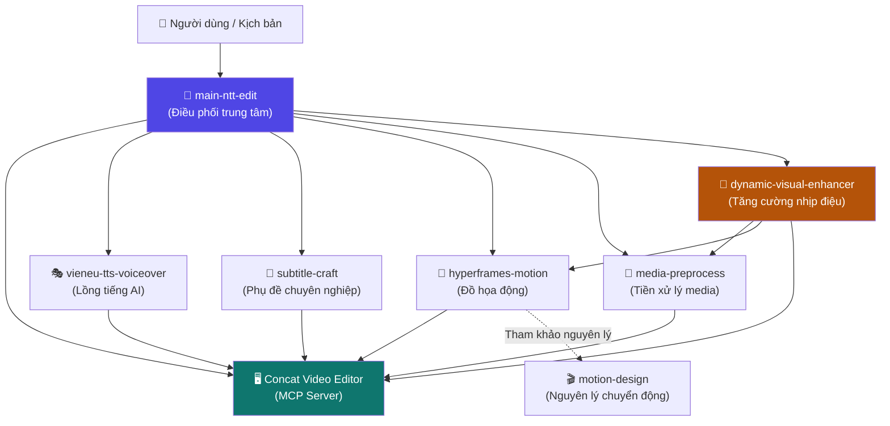
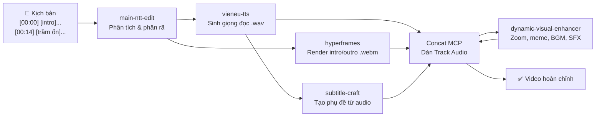
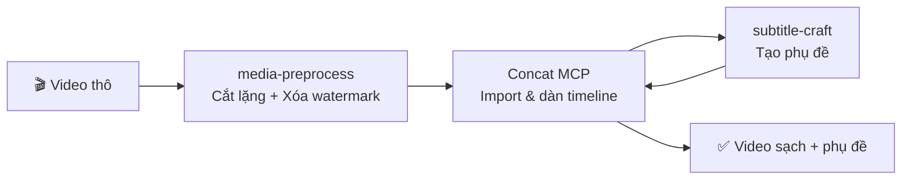

# NttDzEditVideo — Bộ Skill Biên Tập Video AI Tự Động

Hệ sinh thái 7 skill chuyên biệt giúp AI Agent tự động biên tập video chuyên nghiệp: từ lồng tiếng, phụ đề, đồ họa động, đến tăng cường nhịp điệu thị giác — tất cả điều phối qua **Concat Video Editor MCP**.

---

## Yêu Cầu Hệ Thống

| Thành phần | Yêu cầu |
|-----------|---------|
| Hệ điều hành | Windows 10 / 11 (64-bit) |
| GPU | NVIDIA RTX 3060+ (CUDA 12.4) |
| Python | 3.10 (bắt buộc) — qua Conda env `NttDzEditVideo` |
| Node.js | LTS (cho Hyperframes) |
| eSpeak-NG | `C:\Program Files\eSpeak NG` (cho VieNeu-TTS) |
| Concat Editor | `E:\EDIT\Concat\concat.exe` — bật Automation Server tại `127.0.0.1:7420` |

> Chi tiết cài đặt đầy đủ xem [SETTING.md](SETTING.md) và [README_SETUP.md](skills/main-ntt-edit/README_SETUP.md).

---

## Kiến Trúc Hệ Sinh Thái



---

## Tổng Quan Skills

### Skill lõi — Điều phối

| Skill | Mô tả | SKILL.md |
|-------|--------|----------|
| **main-ntt-edit** | Nhạc trưởng: nhận diện ý định, phân rã kịch bản, điều khiển Concat MCP và gọi các sub-skill | [Xem](skills/main-ntt-edit/SKILL.md) |

### Skills chuyên biệt — Tạo tài nguyên

| Skill | Mô tả | Công cụ CLI | SKILL.md |
|-------|--------|-------------|----------|
| **vieneu-tts-voiceover** | Đạo diễn & lồng tiếng AI 48kHz giàu cảm xúc, nhân bản giọng nói | `vieneu.bat` | [Xem](skills/vieneu-tts-voiceover/SKILL.md) |
| **subtitle-craft** | Tạo, ghép nối, kiểm định phụ đề (SRT/VTT/ASS) với 8 preset styling & QC tự động | `subtitle_engine.py` | [Xem](skills/subtitle-craft/SKILL.md) |
| **hyperframes-motion** | Render đồ họa chuyển động (Intro, Outro, Lower-third, counter) bằng HTML/CSS/GSAP | `hyperframes.bat` | [Xem](skills/hyperframes-motion/SKILL.md) |
| **media-preprocess** | Cắt khoảng lặng, xóa phụ đề cứng/watermark, tải B-roll/meme/nhạc nền/SFX | `auto-editor.bat`, `vsr.bat`, `yt-dlp.bat` | [Xem](skills/media-preprocess/SKILL.md) |

### Skill nâng cao — Điều phối liên hoàn

| Skill | Mô tả | SKILL.md |
|-------|--------|----------|
| **dynamic-visual-enhancer** | Đạo diễn nhịp điệu: phân tích giọng đọc/hình ảnh, tự động chèn zoom/shake/meme/BGM/SFX chống nhàm chán | [Xem](skills/dynamic-visual-enhancer/SKILL.md) |

### Skill tham khảo

| Skill | Mô tả | Nguồn gốc | SKILL.md |
|-------|--------|------------|----------|
| **motion-design** | Nguyên lý chuyển động (timing, easing, Disney principles) — tham khảo khi thiết kế animation | LottieFiles (MIT) | [Xem](skills/motion-design/SKILL.md) |

---

## Công Cụ CLI & Đường Dẫn

Mọi lệnh CLI chạy trong môi trường Conda `NttDzEditVideo` hoặc qua file `.bat` wrapper:

| Công cụ | Chức năng | Wrapper / Lệnh |
|---------|-----------|-----------------|
| **FFmpeg / FFprobe** | Xử lý video/audio | `conda run -n NttDzEditVideo ffmpeg` |
| **VieNeu-TTS** | Tổng hợp giọng nói tiếng Việt | `F:\A_Tool\Tools\VieNeu-TTS\vieneu.bat` |
| **Hyperframes** | Render đồ họa động từ HTML/CSS/JS | `F:\A_Tool\Tools\hyperframes\hyperframes.bat` |
| **auto-editor** | Cắt khoảng lặng tự động | `F:\A_Tool\Tools\auto-editor\auto-editor.bat` |
| **VSR (video-subtitle-remover)** | Xóa phụ đề cứng / watermark bằng AI | `F:\A_Tool\Tools\video-subtitle-remover\vsr.bat` |
| **yt-dlp** | Tải video/audio đa nền tảng | `F:\A_Tool\Tools\yt-dlp\yt-dlp.bat` |
| **Concat MCP** | Điều khiển timeline video editor | MCP Server qua `concat.exe --mcp window` |

---

## Cấu Trúc Thư Mục

```
NttDzEditVideo/
├── README.md                              # ← Bạn đang đọc file này
├── SETTING.md                             # Hướng dẫn cài đặt Conda, tools, MCP
├── Lưu ý.txt                             # Ghi chú nhanh CLI & token
├── .gitignore
│
├── rules/
│   └── GEMINI.md                          # Thông tin kết nối Concat (IP, Token)
│
└── skills/
    ├── main-ntt-edit/                     # Điều phối trung tâm
    │   ├── SKILL.md
    │   └── README_SETUP.md                # Hướng dẫn cấu hình Concat MCP
    │
    ├── vieneu-tts-voiceover/              # Lồng tiếng AI
    │   └── SKILL.md
    │
    ├── subtitle-craft/                    # Phụ đề chuyên nghiệp
    │   ├── SKILL.md
    │   └── scripts/
    │       └── subtitle_engine.py         # Engine QC, concat, styling (~44KB)
    │
    ├── hyperframes-motion/                # Đồ họa chuyển động
    │   └── SKILL.md
    │
    ├── media-preprocess/                  # Tiền xử lý media
    │   └── SKILL.md
    │
    ├── dynamic-visual-enhancer/           # Tăng cường nhịp điệu
        └── SKILL.md

```

---

## Luồng Làm Việc Điển Hình

### Luồng 1 — Dựng video từ kịch bản có mốc thời gian



### Luồng 2 — Biên tập video có sẵn (cắt lọc + thêm phụ đề)



---

## Cẩm Nang Cú Pháp Kịch Bản & Thẻ Ngữ Nghĩa

### 1. Phân đoạn & Thần thái kịch bản (`main-ntt-edit`)
- `[00:14] [trầm ổn] Nội dung câu thoại...`: Đặt tại mốc `14.0s`, giọng đọc trầm ấm.
- `[intro] [ngạo nghễ] Lời mở đầu video...`: Render đồ họa intro `[intro]` qua Hyperframes và đọc với sắc thái cao ngạo.
- `[outro] Lời kết thúc...`: Nối tiếp vào cuối timeline.

### 2. Thẻ cảm xúc & Giọng đọc (`vieneu-tts-voiceover`)
- **Hiệu ứng hơi thở/cảm xúc**: `[cười]`, `[thở dài]`, `[hắng giọng]`. Đặt trực tiếp trong câu nói, giọng đang chọn sẽ tự biểu cảm tự nhiên.
- **Phân vai & Biến thể giọng**:
  - `-v "nữ chính"`: Giọng dẫn truyện chính xuyên suốt kịch bản.
  - `-v "sukuna (uy quyền)"`: Biến thể trầm đục, uy nghiêm.
  - `-v "sukuna (ngạo mạn)"`: Biến thể gằn giọng, khiêu khích.
  - `-r "duong_dan\mau.wav"`: Nhân bản giọng tức thì từ file mẫu (5–15s).

### 3. Thẻ ngữ nghĩa tạo kiểu phụ đề (`subtitle-craft`)
- **Nhấn mạnh từ khóa**: `**từ khóa**` hoặc `==từ khóa==` (tự động đổi màu accent của preset).
- **Màu tuỳ chọn RGB**: `[#EF4444:cụm từ báo động]` (tô màu đỏ hex trực tiếp).
- **Phân màu nhân vật**: `{S1} Câu thoại người 1`, `{S2} Câu phản hồi người 2`.
- **Né che khuất**: `{top}` đặt đầu dòng để đẩy phụ đề lên trên khi có lower-third hoặc UI dưới đáy.

---

## Sơ Đồ Bố Trí Track Chuẩn Trên Concat MCP

| Lane / Track ID | Loại nội dung | Mô tả chi tiết |
| :--- | :--- | :--- |
| **Video Track 3 (Overlay)** | Đồ họa & Meme Alpha | File `.webm` nền trong suốt từ Hyperframes, meme phông xanh đã tách nền |
| **Video Track 2 (B-Roll)** | B-Roll minh họa | Đoạn trích 2.5–3.5s đè lên cảnh nói để chống nhàm chán |
| **Video Track 1 (Base)** | Video gốc / Camera ảo | Clip nhân vật nói (talking-head), các đoạn Punch-in Zoom, Ramp Zoom |
| **Subtitle Track** | Phụ đề & Title | Lớp chữ phụ đề đồng bộ lời thoại, thanh tiêu đề Headline / CTA |
| **Audio Track 1** | Giọng thoại (Voiceover) | File `.wav` 48kHz từ VieNeu-TTS hoặc tiếng micro gốc |
| **Audio Track 2** | SFX & Meme Audio | Tiếng động `whoosh`, `pop`, `ding`, `boom` khớp chuyển động |
| **Audio Track 3** | Nhạc nền (BGM) | Nhạc nền không bản quyền đã chuẩn hóa `-24 LUFS`, ngắt nhẹ tại meme |

---

## Bảng Đánh Giá & Điểm Số Hệ Thống

| Xếp hạng | Skill | Điểm | Điểm mạnh nổi bật |
|:---:|---|:---:|---|
| 👑 **1** | **subtitle-craft** | **9.5/10** | Script engine Python độc lập (44KB), 8 preset styling, QC tự động, kẹp ranh giới chống lệch nhịp khi concat |
| 🎭 **2** | **vieneu-tts-voiceover** | **9.0/10** | Đạo diễn âm thanh theo cốt truyện, kỹ thuật TTS Text Engineering, phân biệt rạch ròi thẻ nội tại vs vai diễn |
| 🎼 **3** | **main-ntt-edit** | **8.5/10** | Bảng Intent Routing chuẩn xác, ánh xạ tool Concat MCP toàn diện, DSL kịch bản trực quan |
| 🎨 **4** | **hyperframes-motion** | **8.5/10** | Công thức tự động tính thời lượng, xuất `.webm` Alpha chuẩn `yuva420p`, bàn giao mốc âm thanh Motion-SFX |
| 🧠 **5** | **dynamic-visual-enhancer** | **8.5/10** | Trigger Detection 4 nguồn tín hiệu, kỹ thuật FFmpeg camera ảo tối ưu NVENC, sơ đồ đa tầng video/audio |
| 🔧 **6** | **media-preprocess** | **8.0/10** | Bộ công cụ thực dụng (auto-editor, VSR AI, yt-dlp, FFmpeg), chuẩn hóa LUFS và tách nền phông xanh |

> Chi tiết phân tích từng tiêu chí xem tại báo cáo [skill-review.md](file:///C:/Users/ASUS/.gemini/antigravity/brain/5544462a-8f38-4921-a0da-5cee0688a06c/skill-review.md).

---

## Khắc Phục Sự Cố Thường Gặp (Troubleshooting)

1. **Lỗi tiếng Việt có dấu trong PowerShell khi chạy CLI**:
   - Ép console sử dụng UTF-8 trước khi gọi lệnh:
     ```powershell
     [Console]::InputEncoding = [Console]::OutputEncoding = [System.Text.Encoding]::UTF8
     ```
2. **Lỗi tràn VRAM GPU (CUDA Out of Memory) trên RTX 3060**:
   - Cấm chạy song song `vsr.bat`, `vieneu.bat` hoặc render Concat cùng lúc.
   - Với video 2K/4K, nên dùng `auto-editor` cắt ngắn đoạn cần dùng trước khi đưa qua `vsr.bat`.
3. **Mất kết nối Concat MCP (`Connection Refused` hoặc `Unauthorized`)**:
   - Kiểm tra `concat.exe` đã mở và đã bật switch **"Script và ứng dụng"** trong Cài đặt -> Tự động hóa.
   - Kiểm tra token tại [GEMINI.md](rules/GEMINI.md) khớp với Token trong giao diện Concat.
4. **Overlay `.webm` bị đen nền thay vì trong suốt**:
   - Kiểm tra lệnh render đã có cờ `-auto-alt-ref 0` và pixel format là `yuva420p`.

---

## Quy Tắc Bắt Buộc

1. **Môi trường thực thi**: Mọi lệnh CLI (`ffmpeg`, `vieneu`, `hyperframes`, v.v.) **bắt buộc** chạy qua `conda run -n NttDzEditVideo` hoặc file `.bat` wrapper tương ứng — không dùng Python/FFmpeg hệ thống.
2. **Bảo vệ GPU**: Chạy **tuần tự** các tác vụ nặng GPU (`vsr`, `vieneu`, Concat render) — RTX 3060 không đủ VRAM để chạy song song.
3. **Bảo toàn file gốc**: Mọi file tạm lưu vào `<PROJECT_DIR>\temp_assets\<tên_skill>\` — tuyệt đối không ghi đè tư liệu gốc.
4. **Cấm tự ý xuất video**: Không gọi `export_start` khi người dùng chưa yêu cầu — luôn dừng ở `project_save`.
5. **Kết nối Concat MCP**: Server tại `127.0.0.1:7420` — phải bật Automation trong Concat trước khi dùng.
